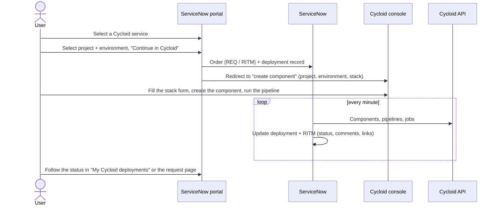
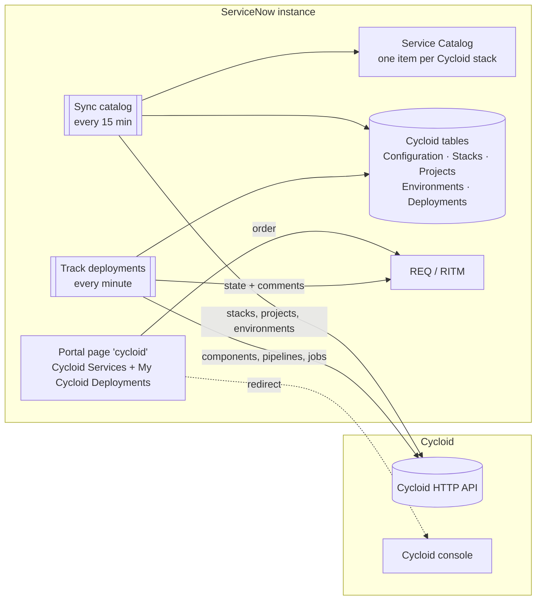

# Cycloid connector for ServiceNow

Self-service for Cycloid from the ServiceNow portal. The connector publishes Cycloid stacks as ServiceNow services. Users pick one, choose a Cycloid project and environment, then finish and deploy in the Cycloid console. ServiceNow follows the deployment pipeline and updates the request on its own.

- Scoped application `x_1829062_cycloi_1` ("Cycloid Stack Catalog Connector"), version 2.0.1
- Targets: ServiceNow Zurich, Cycloid SaaS (EU and US consoles)
- Design details: [docs/design.md](docs/design.md)

## User flow

1. **Browse services.** The *Cycloid services* page of the portal lists the Cycloid stacks published in ServiceNow. They are also available as catalog items in the Service Catalog.
2. **Pick a target.** The user selects a service, then an existing Cycloid **project** and one of its **environments**.
3. **Continue in Cycloid.** When the user validates the form, ServiceNow creates the request (REQ/RITM) and sends the user to the Cycloid console. The user lands on the *create component* page of the chosen project and environment, with the selected stack shown.
4. **Configure and deploy in Cycloid.** The user fills in the stack form as usual, creates the component and runs its pipeline.
5. **Status in ServiceNow.** The connector detects the new component, follows its pipeline and updates the request:

| What happens in Cycloid | Deployment status | Requested item (RITM) |
|---|---|---|
| Request sent, component not created yet | Awaiting component | Work in Progress, with a "Continue in Cycloid" link |
| Component created, pipeline not started | Waiting for pipeline | Work in Progress |
| A pipeline job is pending or running | Running | Work in Progress |
| A job failed (the user can fix it and re-run) | Failed | Work in Progress |
| The deployment job succeeded | Succeeded | Closed Complete |
| Nothing created or deployed within the configured delay | Timed out | Closed Incomplete |

Each step adds a comment to the request with a link to the component or build in Cycloid. The *My Cycloid deployments* panel on the same page shows the user's requests and their live status.



## Architecture



| Component | Type | What it does |
|---|---|---|
| `CycloidApi` | Script include | Cycloid API client (API key, pagination, errors) and console links |
| `CycloidSync` | Script include | Stacks → catalog items; projects and environments → reference tables |
| `CycloidDeploymentTracker` | Script include | Places the order, creates the deployment record, finds the component, follows the pipeline, updates the RITM |
| Cycloid - Sync catalog | Scheduled job (15 min) | Runs `CycloidSync` |
| Cycloid - Track deployments | Scheduled job (1 min) | Runs `CycloidDeploymentTracker.poll()` |
| Cycloid - Create deployment | Business rule (async, `sc_req_item`) | Handles orders placed from the standard Service Catalog |
| Cycloid deployment target | Variable set | *Cycloid project* and *Cycloid environment* variables on every Cycloid item |
| Cycloid Services | Portal widget | Service cards, project/environment dialog, redirect to Cycloid |
| My Cycloid Deployments | Portal widget | The user's deployments, status and links |
| `cycloid` | Portal page | Hosts both widgets |
| Test connection / Sync now | UI actions | Buttons on the configuration form |

Tables (application menu **Cycloid**): *Configuration*, *Stacks (catalog items)*, *Projects*, *Environments*, *Deployments*.

The connector only reads from the Cycloid API: it lists stacks, projects, environments, components, pipelines and jobs. All calls are outbound from ServiceNow to Cycloid; nothing calls into ServiceNow.

## Installation

Prerequisites:

- A ServiceNow instance (a PDI works) with the **Service Catalog** and **Service Portal** plugins (active by default), and an admin account.
- Outbound HTTPS from the instance to the Cycloid API (for example `api.us.cycloid.io` or `http-api.cycloid.io`).
- A Cycloid organization and an **API key** (Cycloid console → organization settings → API keys). Give it a role that can read stacks, projects, environments, components and pipelines.

Install the application:

1. Download [`dist/cycloid-servicenow-connector-v2.0.1.xml`](dist/cycloid-servicenow-connector-v2.0.1.xml).
2. In ServiceNow, open **System Update Sets → Retrieved Update Sets** and click **Import Update Set from XML**. Upload the file.
3. Open the retrieved update set *Cycloid connector v2.0.1* and click **Preview Update Set**, then **Commit Update Set**.
4. Refresh the browser. The **Cycloid** menu appears in the navigator.

## Configuration

1. **Create the target category** (Service Catalog → Catalog Definitions → Maintain Categories), for example "Cloud services" in the *Service Catalog* catalog. Copy its sys_id.
2. **Fill in the configuration**: **Cycloid → Configuration → New**, then save.

   | Field | Value |
   |---|---|
   | organization_canonical | Your Cycloid organization canonical, e.g. `acme` |
   | api_url | `https://api.us.cycloid.io` (US) or `https://http-api.cycloid.io` (EU), no `/v1` |
   | console_url | `https://console.us.cycloid.io` (US) or `https://console.cycloid.io` (EU) |
   | api_key | The Cycloid API key |
   | catalog_category | sys_id (or title) of the category from step 1 |
   | Component timeout (hours) | How long to wait for the component to be created (default 24) |
   | Pipeline monitoring window (hours) | How long to follow the pipeline once the component exists (default 24) |
   | Deployment job pattern | Regex matching the pipeline job that means "deployed" (default `apply\|deploy`). If no job matches, the last job of the pipeline is used. |

3. On the configuration form, click **Test connection**. You should see the number of stacks and projects visible with the key.
4. Click **Sync now** to publish the stacks and load the projects and environments right away. After that, the sync runs every 15 minutes.
5. Open the portal page: **Cycloid → Service Portal page**, or `https://<instance>.service-now.com/sp?id=cycloid`. The page also works in other portals, such as `/esc?id=cycloid`. To add it to a portal menu, create a menu item pointing to the page `cycloid`.

Widget options (Service Portal → Instance options):

- *Cycloid Services*: title, and **Open the Cycloid console in a new tab** (off by default: the redirect happens in the same tab).
- *My Cycloid Deployments*: title, number of requests shown.

## Demo script

1. Log in to the ServiceNow portal and to the Cycloid console in the same browser.
2. Open `sp?id=cycloid`, search for a service and click it.
3. Select a project and an environment, then click **Continue in Cycloid**.
4. In Cycloid, the *create component* page opens on the selected project and environment with the stack listed. Select it, fill in the form, create the component and start the pipeline.
5. Back in ServiceNow, *My Cycloid deployments* moves from *Awaiting component* to *Running* and then *Succeeded*. It refreshes every 30 seconds while a deployment is active. The request (RITM) receives the comments and is closed when the deployment job succeeds.

## Operations

- **Logs**: System Logs → All, filter on messages starting with `[Cycloid]`. The API key is never logged.
- **Deployments**: Cycloid → Deployments shows each request with its matched component, the current pipeline job and build, links to Cycloid, the last check time and the last message (including API errors).
- **Scheduled jobs**: *Cycloid - Sync catalog* and *Cycloid - Track deployments* (System Definition → Scheduled Jobs). Use **Execute Now** to run one immediately.
- **Troubleshooting**:
  - *"The Cycloid connector is not configured yet"*: a field of the configuration record is empty.
  - *HTTP 401/403* in a deployment message or on Test connection: wrong API key or missing permissions on the key's role.
  - *HTTP 404*: check `organization_canonical` and that `api_url` has no path.
  - A stack is missing: blueprints and stacks with *hidden* visibility are not published. Otherwise run **Sync now**.
  - A project or environment is missing in the form: run **Sync now**. Inactive records are those removed from Cycloid.

## Upgrading from v1

Import the v2 update set on top of v1. The application keeps the same scope and sys_id, and the v1 configuration record is reused. The v1 *Cycloid Stacks* widget is removed and replaced by the *Cycloid services* page. Existing scheduled jobs that call `new x_1829062_cycloi_1.CycloidIntegration().syncStacks()` keep working, and now sync projects and environments as well.

## Repository layout

```
dist/                      ready-to-import update set
docs/design.md             v2 design
servicenow/build.py        builds the update set from the sources below
servicenow/base/           v1 records kept as-is (application, roles, v1 tables, ACLs, privileges)
servicenow/src/            readable sources
  script_includes/         CycloidApi, CycloidSync, CycloidDeploymentTracker, CycloidIntegration
  business_rules/          Cycloid - Create deployment
  scheduled_jobs/          Sync catalog, Track deployments
  ui_actions/              Test connection, Sync now
  catalog_client_scripts/  clears the environment when the project changes
  widgets/                 cycloid_catalog, cycloid_my_deployments (template, client, server, css, options)
tests/                     logic tests (ServiceNow and Cycloid fakes) and widget UI preview
questions.md               open questions and next steps
```

## Development

```bash
python3 servicenow/build.py   # regenerate dist/cycloid-servicenow-connector-v2.0.1.xml
node tests/run.js             # logic tests, no dependency needed
npm install && npm run test:ui  # optional: render the widgets in headless Chromium (screenshots in tests/ui/out)
```

Edit the sources in `servicenow/src`, rebuild, and re-import the update set. sys_ids are stable, so records are updated in place. To change records directly in an instance instead, link the application to a Git branch from ServiceNow Studio. ServiceNow then writes its own source-control layout, which you can review against `servicenow/src`.

## Support

For help with configuration or customization, contact your Cycloid representative or open an issue in this repository.
