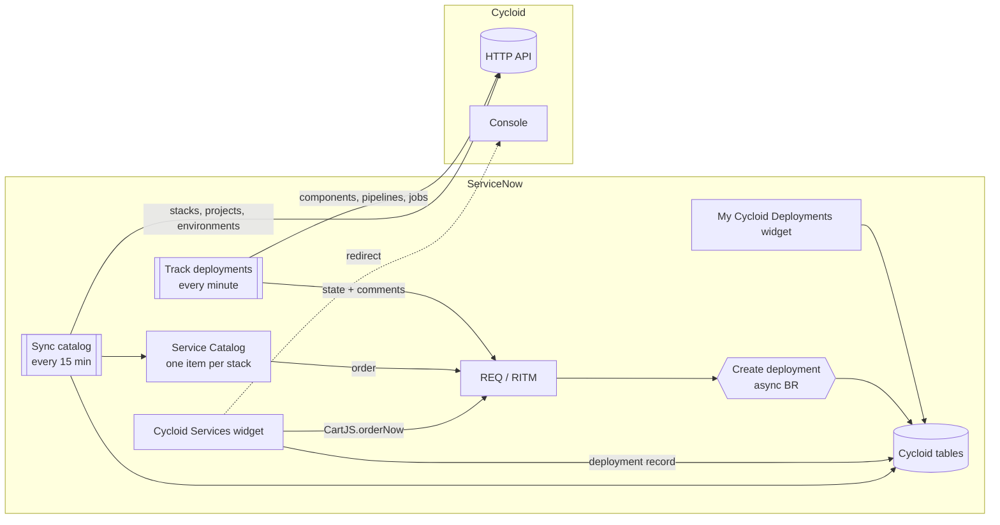
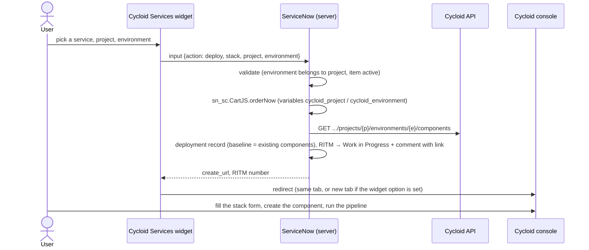
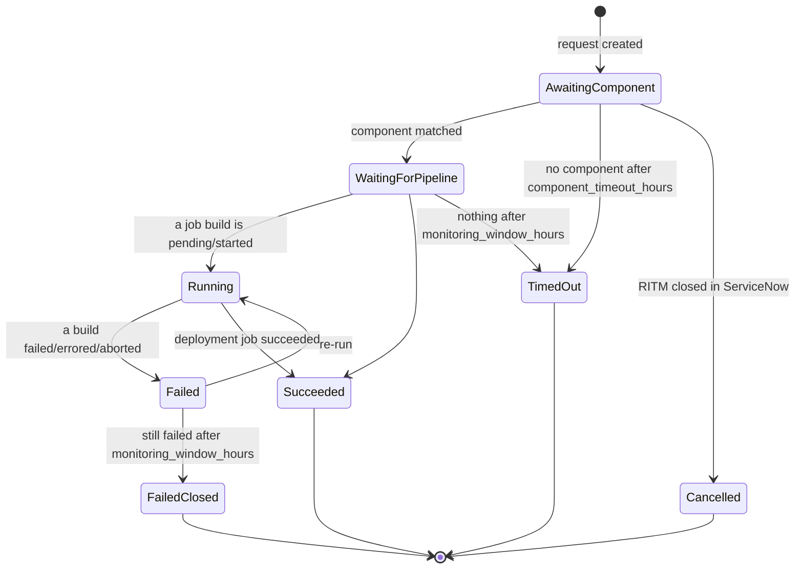

# Cycloid connector for ServiceNow — v2 design

This document describes how v2 of the connector is built. The [README](../README.md) covers installation and day-to-day use.

## 1. Goal

ServiceNow users pick a Cycloid service in the ServiceNow portal, choose an existing Cycloid project and environment, and land on the Cycloid console's "create component" page for that project and environment, with the stack list filtered on the selected stack. They finish the stack form in Cycloid and deploy as usual. ServiceNow follows the deployment and keeps the request status in line with the Cycloid pipeline.

v2 runs on the Cycloid console and API as they are today; it needs no changes on the Cycloid side.

## 2. Building blocks

| Piece | ServiceNow record | Role |
|---|---|---|
| `CycloidApi` | Script include | Cycloid HTTP client (Bearer API key, pagination, errors) and console deep links |
| `CycloidSync` | Script include | Copies stacks into catalog items, and projects and environments into reference tables |
| `CycloidDeploymentTracker` | Script include | Orders an item for the user, creates the deployment record, matches the Cycloid component, follows its pipeline, updates the RITM |
| `CycloidIntegration` | Script include | v1 entry points (`getStacks`, `syncStacks`) that delegate to v2 |
| Cycloid - Sync catalog | Scheduled job, every 15 min | `CycloidSync.syncAll()` |
| Cycloid - Track deployments | Scheduled job, every 1 min | `CycloidDeploymentTracker.poll()` |
| Cycloid - Create deployment | Async business rule on `sc_req_item` insert | Creates the deployment record when a Cycloid item is ordered from the standard catalog |
| Cycloid deployment target | Catalog variable set | Two reference variables (project, environment) attached to every Cycloid catalog item |
| Cycloid Services (`cycloid_catalog`) | Service Portal widget | Service cards, project/environment dialog, order and redirect |
| My Cycloid Deployments (`cycloid_my_deployments`) | Service Portal widget | The user's deployments with live status and links |
| `cycloid` | Service Portal page | Hosts both widgets (8/4 columns) |
| Test connection, Sync now | UI actions on the configuration form | Admin helpers |
| Cycloid | Application menu | Configuration, stacks, projects, environments, deployments, portal page |



## 3. Data model

All tables live in the `x_1829062_cycloi_1` scope.

### Cycloid Configuration (`x_1829062_cycloi_1_cycloid_config`)

One record. The oldest record wins if there are several.

| Field | Example | Notes |
|---|---|---|
| `organization_canonical` | `acme` | |
| `api_url` | `https://api.us.cycloid.io` | No version suffix. A trailing `/v1` is removed automatically. |
| `console_url` | `https://console.us.cycloid.io` | |
| `api_key` | | Sent as `Authorization: Bearer`. Readable by admins only, never logged. |
| `catalog_category` | sys_id of an `sc_category` | The title is accepted too. The category's catalog is copied to `sc_catalogs`. |
| `component_timeout_hours` | 24 | How long to wait for the component to be created |
| `monitoring_window_hours` | 24 | How long to follow the pipeline after the component is found |
| `deploy_job_pattern` | `apply\|deploy` | Regex (case-insensitive) picking the job that means "deployed". Falls back to the last job. |

### Cycloid Stack (`x_1829062_cycloi_1_cycloid_stack`, extends `sc_cat_item`)

There is one catalog item per publishable stack, keyed on `u_cycloid_stack_ref` (`org:canonical`). The sync writes `name`, `short_description`, `description` (HTML), `category`, `sc_catalogs`, `meta` (keywords), `picture`, `no_cart`, `no_quantity`, `active`, `stack_canonical`, `image_url` and `last_synced`.

### Cycloid Project / Cycloid Environment

`x_1829062_cycloi_1_cycloid_project` (`name`, `canonical`, `description`, `active`, `last_synced`) and `x_1829062_cycloi_1_cycloid_environment` (`name`, `canonical`, `project`, `active`, `last_synced`). An environment record represents the link between an environment and a project, so its key is the pair (project, canonical).

### Cycloid Deployment (`x_1829062_cycloi_1_cycloid_deployment`)

There is one record per RITM. It holds:

- the target: `stack`, `project`, `environment`, plus canonical copies;
- the matching state: `baseline_components`, `component_*`;
- the pipeline state: `pipeline_name`, `job_name`, `build_*`;
- the status: `status`, `status_message`, `active`;
- timestamps: `requested_at`, `component_found_at`, `finished_at`, `last_checked`;
- links: `create_url`, `component_url`, `build_url`.

`active = false` means the record is no longer polled.

## 4. Flows

### 4.1 Catalog sync

```
GET /organizations/{org}/service_catalogs          (paged, 100 per page)
  skip blueprint == true, visibility == "hidden"
  upsert catalog item by u_cycloid_stack_ref, attach variable set (sn_sc.CatalogItemVariableSetM2M)
  download image only if the URL changed → attachment "picture" on ZZ_YY<table>
  deactivate items whose stack is gone
GET /organizations/{org}/projects                  (paged)
GET /organizations/{org}/projects/{p}/environments (paged)
  upsert projects / environments, deactivate missing ones
```

Records are never deleted, so existing requests keep their references.

### 4.2 Ordering from the portal



The console URL is `{console}/organizations/{org}/projects/{p}/environments/{e}/components/create?canonical={stack canonical}`. The console reads the `canonical` query parameter into the stack search box, so the list shows only the selected stack.

When the user orders from the standard Service Catalog instead, the item form shows the two variables. The async business rule then creates the deployment record, and the "Continue in Cycloid" link is posted as a comment on the RITM. Both paths call the same idempotent `ensureDeploymentForRitm()`.

### 4.3 Tracking

The tracking job runs every minute for every deployment with `active = true`.



**Component matching.** A component in the selected project and environment matches when all of these are true:

- it uses the requested stack (`service_catalog.ref`);
- it was not in the baseline taken at order time;
- it is not already linked to another deployment;
- it was created after the request, with 5 minutes of clock skew allowed.

If several match, the oldest one wins, so two requests on the same stack and environment get distinct components in creation order.

**Pipeline evaluation.** The tracker reads `GET .../components/{c}/pipelines`, then `GET .../pipelines/{name}/jobs` for each pipeline. Builds created before the request are ignored. The checks run in this order:

1. The deployment job's `finished_build` succeeded → **Succeeded**.
2. Any job's `next_build` is `pending` or `started` → **Running**.
3. The most recent `finished_build` that is `failed`, `errored` or `aborted` → **Failed**. The request stays open so the user can fix the problem and re-run.
4. Otherwise → **Waiting for pipeline**.

**RITM mapping.** The RITM gets a customer-visible comment on each transition, with a link to the component or build. A failure produces a new comment only when it comes from a new build.

| Deployment status | RITM state |
|---|---|
| Awaiting component, Waiting for pipeline, Running, Failed | 2 – Work in Progress |
| Succeeded | 3 – Closed Complete |
| Timed out, Failed (after the monitoring window) | 4 – Closed Incomplete |
| Cancelled (RITM closed in ServiceNow) | unchanged |

**Errors.** When an API call fails, the deployment keeps its status and records the error in `status_message`. The time limits still apply. A 404 once the component is known means the component, its pipeline or the project is gone in Cycloid: the deployment ends as **Failed** and the RITM is set to Closed Incomplete. `requested_item` is unique, and the deployment record is inserted before any API call. If the portal and the business rule both try to create it, the second insert fails and returns the existing record.

## 5. Cycloid API usage

| Purpose | Endpoint |
|---|---|
| Stacks | `GET /organizations/{org}/service_catalogs` |
| Projects | `GET /organizations/{org}/projects` |
| Environments of a project | `GET /organizations/{org}/projects/{p}/environments` |
| Components | `GET /organizations/{org}/projects/{p}/environments/{e}/components` |
| Pipelines of a component | `GET .../components/{c}/pipelines` |
| Jobs (with `finished_build` / `next_build`) | `GET .../components/{c}/pipelines/{pipeline}/jobs` |

All calls are read-only. Answers use the `{"data": ..., "pagination": {...}}` envelope. Lists are read with `page_index` / `page_size=100` until `pagination.total` is reached, with a cap of 100 pages. Filtering is done in ServiceNow, so no query filter is sent to the API. Timestamps are Unix seconds; milliseconds are accepted too.

Console deep links:

| Link | Path (after `{console}/organizations/{org}`) |
|---|---|
| Create component | `/projects/{p}/environments/{e}/components/create?canonical={stack}` |
| Component | `/projects/{p}/environments/{e}/components/{c}` |
| Build | `/projects/{p}/environments/{e}/components/{c}/pipelines/{pipeline}/jobs/{job}/builds/{build}` |

## 6. Security

- Configuration table: every operation needs `x_1829062_cycloi_1.admin` (or `admin`).
- Stacks, projects and environments: readable by any logged-in user, because the catalog items and the reference pickers need it. Writing needs the app admin role.
- Deployments: the table needs the app admin role. End users see their own deployments through the widget, whose server script filters on `requested_for = current user`.
- The API key is never written to the logs. Errors carry the HTTP status and the Cycloid error code only.
- Cross-scope privileges are declared for the global tables and APIs used: `sc_req_item`, `sc_request`, `io_set_item` (read; links are created with the `sn_sc.CatalogItemVariableSetM2M` scoped API), `sc_category`, the RESTMessageV2 methods and `GlideSysAttachment`.

## 7. Packaging

The application keeps the v1 scope (`x_1829062_cycloi_1`) and sys_id, so it upgrades v1 in place. It ships as a single update set, `dist/cycloid-servicenow-connector-v2.0.2.xml`, generated by `servicenow/build.py`:

- `servicenow/base/` holds the v1 records that are kept unchanged (application, roles, v1 tables and fields, ACLs, cross-scope privileges, stack form).
- `servicenow/src/` holds the readable sources (script includes, business rule, jobs, UI actions, catalog client script, widgets).
- `build.py` declares every v2 record (tables, fields, labels, forms, ACLs, variables, page layout, menu) and derives stable sys_ids from fixed keys. Rebuilding and re-importing therefore updates records in place.
- The v1 widget `cycloid_stacks_list` is deleted by the update set.

## 8. Tests

- `tests/run.js` runs the script includes, scheduled jobs, business rule, UI actions and widget server scripts against in-memory fakes of the ServiceNow APIs (`tests/glide-mock.js`) and of the Cycloid API (`tests/cycloid-mock.js`). It covers the sync, pagination, ordering, the business rule's idempotency, matching (baseline, concurrency, other stack or environment), the whole status life cycle, timeouts, cancellation, API errors and the absence of secrets in logs.
- `tests/ui/preview.js` renders both widgets with AngularJS 1.5 and Bootstrap 3, as Service Portal does, using mock data. It drives the dialog in headless Chromium (filter, dependent environment list, submit, error) and saves screenshots.
